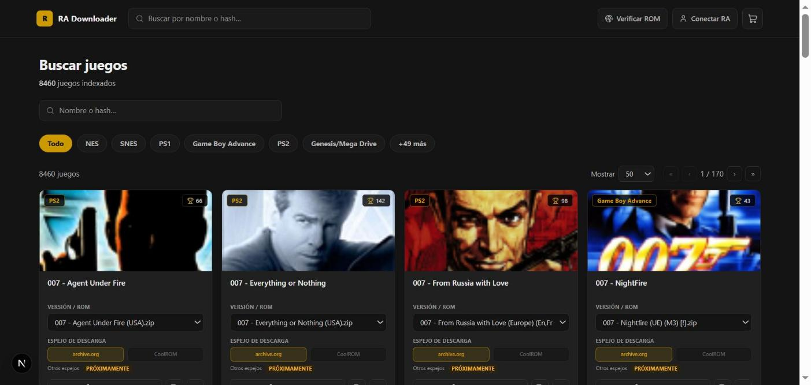
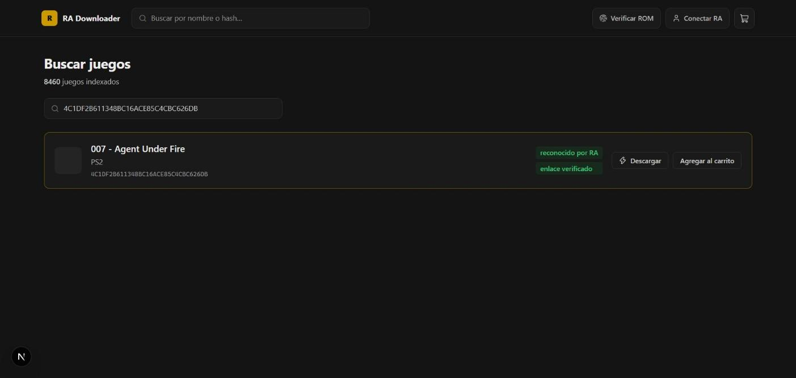
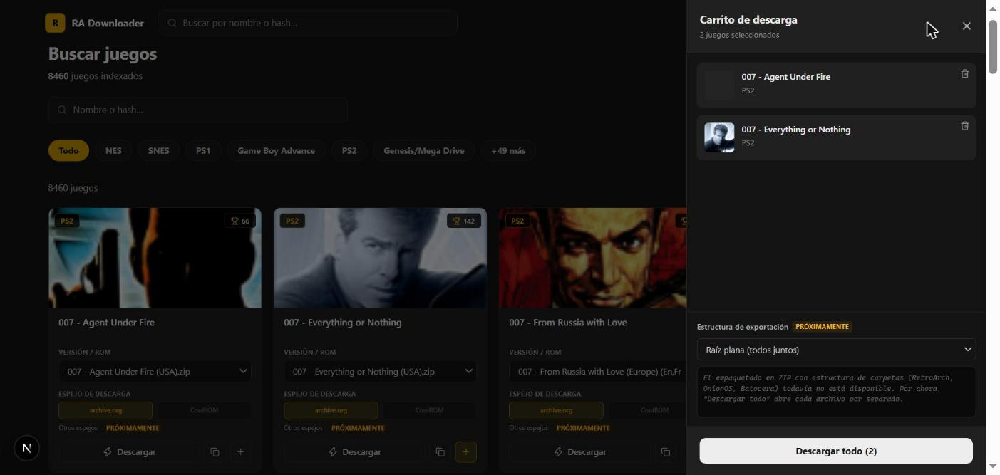

# 🎮 RetroAchievements Downloader

**RetroAchievements Downloader** es una aplicación en **Python** que facilita la descarga de ROMs compatibles con los logros de **RetroAchievements** 🏆.

Permite explorar un catálogo de más de 8.400 juegos, buscar por nombre o por hash, armar un carrito y descargar en lote — además del modo tradicional de "Want to Play" por consola. Está disponible tanto en **versión web** como en **scripts de consola**.

## 🌐 Catálogo web



Grid con portada, logros y versiones por juego; filtros rápidos por consola (y acceso al resto desde "+N más"); carrito persistido en tu navegador (`localStorage`, nunca en el servidor).



Pegás un hash y te dice si es válido, si está reconocido por RetroAchievements y si el enlace de descarga responde — antes de agregarlo al carrito.



"Descargar todo" abre el enlace de cada juego del carrito. En desarrollo: espejos adicionales (CoolROM), exportar el carrito como ZIP con estructura de carpetas lista para RetroArch/OnionOS/Batocera, verificar el hash de un archivo local sin subirlo, y conectar tu cuenta de RetroAchievements para traer tu "Want to Play" directo al catálogo.

## 🚀 Características Principales

✅ **Catálogo navegable**: más de 8.400 juegos, filtrables por consola  
✅ **Búsqueda por hash directo**: pegás el hash y te dice si es válido y descargable  
✅ **Carrito con descarga en lote**: armá una lista y descargá todo de una  
✅ **Lista de deseos (consola)**: descargá juegos desde tu lista personal de "Want to Play"  
✅ **Soporte multiplataforma**: SNES, NES, PSP, PS1, PS2, Genesis, Arcade y más de 50 consolas en total  
✅ **Versión web** disponible en [RetroAchievements Downloader](https://retroachievements.vercel.app/)  
✅ **Interfaz de consola** con múltiples modos de operación


## 📋 Tabla de Contenidos

- [Versiones](#versiones)
- [Cómo utilizar](#cómo-utilizar)
- [Requisitos](#requisitos)
- [Configuración](#configuración)
- [Preguntas Frecuentes](#preguntas-frecuentes)
- [Contribuciones](#contribuciones)

## 🌐 Versiones

### Versión Web
- **URL**: [RetroAchievements Downloader](https://retroachievements.vercel.app/)
- **Descripción**: Catálogo navegable con carrito y descarga en lote, más búsqueda directa por hash (ver capturas arriba)

### Versión de Consola
- **Modo Unificado**: `python main.py` - Permite elegir entre búsqueda directa o lista de deseos
- **Modo Hash Directo**: `python console_mode.py` - Búsqueda directa por hash
- **Modo Lista de Deseos**: `python want_to_play.py` - Descarga desde tu lista "Want to Play"

## 🎯 Cómo Utilizar

### Versión Web
1. **Accede a la web**: [RetroAchievements Downloader](https://retroachievements.vercel.app/)
2. **Inicia sesión en archive.org**: Antes de descargar, inicia sesión en <https://archive.org/>
3. **Buscá**: por nombre (navegás el catálogo filtrando por consola) o pegando un hash directamente
4. **Agregá al carrito** los que quieras, o descargá uno a la vez con el botón "Descargar"
5. **Descargá todo**: desde el carrito, un clic abre el enlace de cada juego seleccionado

### Versión de Consola

#### Opción 1: Modo Unificado (Recomendado)
```bash
python main.py
```
Te permite elegir entre búsqueda directa por hash o lista de deseos.

#### Opción 2: Modos Específicos
```bash
# Búsqueda directa por hash
python console_mode.py

# Lista de deseos
python want_to_play.py
```

#### Ejemplo de Uso
```bash
$ python main.py

🎮 RetroAchievements Downloader

Seleccione el modo de operación:
1. Búsqueda directa por hash
2. Lista de deseos (Want to Play)

Ingrese el número del modo que desea usar [1]: 1

¡Bienvenido a RetroAchievements Downloader!
Modo: Búsqueda directa por hash

Por favor, ingresa el hash que deseas buscar: ABC123DEF456
Hash encontrado. La URL de descarga es: https://archive.org/...
Abriendo URL en el navegador...
```
## 📌 Requisitos

🔹 **Python 3.7+** 🐍  
🔹 **Dependencias**:

```bash
pip install -r requirements.txt
```
## 📁 Estructura del Proyecto

```
RetroArchivement-Download-games/
├── 📁 src/                    # Código fuente refactorizado
│   ├── 📁 core/               # Componentes centrales
│   ├── 📁 strategies/         # Estrategias de búsqueda
│   ├── 📁 factories/          # Generadores de URL
│   ├── 📁 commands/           # Comandos de descarga
│   ├── 📁 utils/              # Utilidades
│   └── 📄 app.py              # Aplicación principal
├── 📁 Data/                   # Datos JSON principales
├── 📁 api/                    # Backend Flask (Vercel)
├── 📁 web/                    # Frontend Next.js/TS (Vercel)
├── 📄 main.py                 # Punto de entrada unificado
├── 📄 console_mode.py         # Modo hash directo
├── 📄 want_to_play.py         # Modo lista de deseos
├── 📄 sync_want_to_play.py    # Genera game_hashes.json desde la API de RA
├── 📄 config.py               # Configuraciones centralizadas
├── 📄 game_hashes.json        # Lista de juegos deseados
├── 📄 .env                    # Variables de entorno
├── 📄 ejemplo.env             # Ejemplo de configuración
└── 📄 requirements.txt        # Dependencias
```

## ⚙️ Configuración

### Archivo de datos principal
Asegúrate de que existe `Data/TamperMonkeyRetroachievements.json` con los hashes de los juegos.

### Lista de deseos
Para usar el modo "Want to Play":
1. **Archivo de juegos**: `game_hashes.json` con tus juegos deseados — se genera automáticamente con `python sync_want_to_play.py` (ver abajo), o se puede armar a mano.
2. **Variables de entorno**: Configura `.env` con tu API Key de RetroAchievements

#### Generar game_hashes.json automáticamente

```bash
python sync_want_to_play.py
```

Trae tu lista real de "Want to Play" desde la API de RetroAchievements, cruza cada hash contra `Data/TamperMonkeyRetroachievements.json` para quedarse solo con los que sí se pueden descargar, y sobreescribe `game_hashes.json`. Requiere `API_KEY` y `RETROACHIEVEMENTS_USERNAME` en `.env`.

### Configuración de API RetroAchievements (para modo "Want to Play")

El modo "Want to Play" puede requerir credenciales de RetroAchievements para generar la lista de juegos deseados.

#### 🔑 **Cómo obtener tu API Key:**

1. **Visita la página de configuración**: [RetroAchievements Web API Settings](https://retroachievements.org/controlpanel.php)
2. **Inicia sesión** en tu cuenta de RetroAchievements
3. **Ve a la sección "Web API Key"**
4. **Copia tu API Key** (aparece como una cadena alfanumérica)

#### ⚙️ **Configurar las credenciales:**

```bash
# 1. Copia el archivo de ejemplo
cp ejemplo.env .env

# 2. Edita .env con tus credenciales
API_KEY=tu_api_key_de_retroachievements_aqui
RETROACHIEVEMENTS_USERNAME=tu_nombre_de_usuario_de_retroachievements
```

#### 📋 **Ejemplo de archivo .env:**

```bash
# Credenciales de RetroAchievements
API_KEY=AbCdEf123456789
RETROACHIEVEMENTS_USERNAME=MiUsuarioRetroAchievements
```

> **💡 Nota**: La API Key es **opcional** para la búsqueda directa por hash. Solo se necesita para generar y gestionar tu lista personal de "Want to Play".

### Personalización avanzada
Edita `config.py` para personalizar:
- Rutas de archivos
- Preferencias de región
- URLs base de descarga
- Parámetros de validación

##  ❓ Preguntas Frecuentes

###  **¿Dónde encuentro el hash de un juego?**

En la página del juego en RetroAchievements, ve a la sección **"Supported Game Files"**. Ahí encontrarás los hashes compatibles.

###  **¿Necesito API Key para usar la aplicación?**

-  **Búsqueda por hash**: ❌ No necesitas API Key

-  **Lista "Want to Play"**: ✅ Sí necesitas API Key para generar/gestionar la lista

###  **¿Dónde obtengo mi API Key de RetroAchievements?**

1.  Ve a: [retroachievements.org/controlpanel.php](https://retroachievements.org/controlpanel.php)

2.  Inicia sesión en tu cuenta

3.  En la sección "Web API Key", copia tu clave

###  **¿Qué consolas están soportadas?**

SNES, NES, PlayStation (1, 2, Portable), Genesis/Mega Drive, Sega CD, Arcade, y más.

###  **¿Los archivos se descargan automáticamente?**

No, la aplicación abre la URL de descarga en tu navegador. Desde ahí puedes descargar el archivo.

##  🙏 Agradecimientos

Este proyecto está basado en el archivo JSON de **RetroAchievements** disponible en [archive.org](https://archive.org/download/retroachievements_collection_v5).

## ⚖️ Aviso legal

- Este proyecto no aloja, modifica ni redistribuye ROMs. Solo facilita el acceso a enlaces públicos en archive.org.
- Los juegos, marcas y contenidos pertenecen a sus respectivos titulares. Su uso está sujeto a las leyes de derechos de autor aplicables.
- El autor/desarrollador no se responsabiliza por el uso indebido de la herramienta ni por eventuales infracciones de copyright por parte de los usuarios.
- El usuario es responsable de verificar que posee los derechos para descargar y usar cada archivo (por ejemplo, copias de seguridad de juegos que posee legalmente).
- RetroAchievements es una plataforma de terceros sin relación oficial con este proyecto.

Consulta también la página de **[FAQ y Aviso legal](/faq)** para más detalles (en la versión desplegada, la encontrarás en el pie de página como "FAQ y Aviso legal").

## 🤝 Contribuciones

Este proyecto es de **código abierto** y cualquier contribución es bienvenida. Si deseas participar:

1. **Fork** el repositorio
2. **Crea** una rama para tu feature (`git checkout -b feature/AmazingFeature`)
3. **Commit** tus cambios (`git commit -m 'Add AmazingFeature'`)
4. **Push** a la rama (`git push origin feature/AmazingFeature`)
5. **Abre** un Pull Request

### Ideas para Contribuir

- 🆕 Agregar soporte para nuevas consolas
- 🔧 Mejorar la interfaz de usuario
- 🐛 Reportar y corregir bugs
- 📚 Mejorar documentación

---

¡Disfruta descargando tus ROMs favoritas de RetroAchievements! 🎮✨